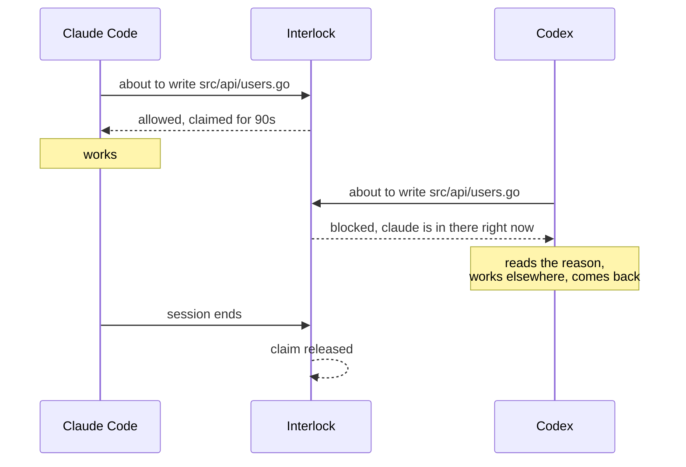

<div align="center">

<picture>
  <source media="(prefers-color-scheme: dark)" srcset="docs/wordmark-dark.svg">
  
</picture>

### Run two AI coding agents in one repo without them overwriting each other

Open Claude Code in one terminal. Open Codex in another. Give them both work.<br>
They see each other. Nothing to configure.

<br>


</div>

---

## The problem

Two agents in one checkout will silently clobber each other. One writes a file,
the other writes the same file, and the first edit is gone with nothing to say it
ever happened.

Every existing answer is **isolation**: give each agent its own git worktree so
they cannot collide because they cannot see each other's files. That works, and
it means you are no longer working in one checkout.

Claude Code's own agent teams share a checkout and have **no file conflict
enforcement at all**. The documented answer is:

> Two teammates editing the same file leads to overwrites. Break the work so each
> teammate owns a different set of files.

That is an instruction to the human. Interlock is that instruction, enforced.

---

## What it looks like

<picture>
  <source media="(prefers-color-scheme: dark)" srcset="docs/panel-dark.png">
  
</picture>

A signalling panel, because an interlocking is one. Files are track sections that
are occupied or clear. Every agent shows an aspect: **green** working, **amber**
waiting, **red** blocked.

---

## Quick start

```bash
go install github.com/gshepptech/interlock/cmd/interlock@latest

cd /your/repo
interlock init        # wires the hooks. Writes no config.
interlock doctor      # confirms it is actually enforcing
interlock dashboard   # the panel, on 127.0.0.1:7717
```

Then open your agents and give them work. That is the whole setup.

> [!IMPORTANT]
> Codex loads project hooks only from a **trusted** project and skips them
> silently otherwise, so half an install looks exactly like a working one.
> `interlock doctor` checks for this by name. It is the one step that cannot be
> done for you.

---

## How it works

Hooks, not MCP. An MCP tool only runs if the model decides to call it. A hook
fires whether the model cooperates or not.



### Three layers, in the order they do work

| | | |
|---|---|---|
| **Awareness** | Needs no rules, does most of the work | Each agent is told who else is live and which directories they are working in. An agent that knows where its peer is usually stays out of the way without ever being refused anything. |
| **Claims** | The backstop | Writing a file claims it for 90 seconds, renewed on every touch, released when the session ends. A second agent is refused and told who has it. |
| **Verification** | For what cannot be judged in advance | `python3 build.py` writes somewhere and nothing before it runs says where. The tree is snapshotted either side of the command, and anything that landed out of bounds is reported back to the agent, which can then revert it. |

<details>
<summary><b>Why the wording of a refusal matters more than it sounds</b></summary>

<br>

The block message says, in these words, that it is **a timing conflict, not a
permission one**.

An earlier version phrased it as a permission problem, and agents responded by
looking for another way in: a shell command, an interpreter, anything that was
not the tool that had just refused them. Framing it as scheduling is what makes
an agent wait and retry instead of routing around the guard.

Same mechanism, opposite behaviour, purely from the sentence.

</details>

<details>
<summary><b>Closing the obvious bypass</b></summary>

<br>

Enforcement only at the edit tool is sidestepped by `sed -i`. Shell commands are
scanned for the paths they are likely to write, which turned out to need real
care:

- `sed -n '1,10p' file` **reads**, and flagging it would block normal work
- `find . | xargs sed -i ...` hides the real command behind a wrapper
- `cd src && tee ../src/api/users.go` means `src/api/users.go`
- `"$TARGET"` cannot be resolved at all, and pretending otherwise is worse than
  admitting it

What cannot be resolved is reported rather than blocked, then verified after the
fact. Blocking every `python3` invocation would get the tool uninstalled.

</details>

<details>
<summary><b>Optional: hard rules, when the automatic behaviour cannot infer one</b></summary>

<br>

Most repos never need this. `interlock init --with-territory` writes:

```json
{
  "teams": {
    "backend":  { "owns": ["src/api/**", "migrations/**"], "shared": ["src/types/**"], "agents": ["claude"] },
    "frontend": { "owns": ["src/components/**"], "agents": ["codex"] }
  }
}
```

A team can span vendors: two Claude sessions and a Codex session can all be
`backend`. `INTERLOCK_TEAM` puts one session on a team other than its agent's
default. Everything automatic still applies on top.

</details>

---

## Proof

Not a description of intended behaviour. These are real Claude Code and Codex
sessions in one shared checkout.

**Two agents, running at the same time, nothing configured.** Claude was told to
make three separate edits to `src/shared.ts`. While it worked, Codex was told to
add a comment to the same file. Codex reported:

> The first write was blocked because `claude` held `src/shared.ts`. I waited,
> re-read the file, saw another comment had been added, then applied the
> requested comment without removing that change.

All four edits survived. Neither agent lost the other's work, and neither was
told anything by a human.

<details>
<summary><b>More of the record</b></summary>

<br>

**Territory, both directions.** With `claude` on backend and `codex` on frontend:

| Agent | Own territory | The other team's |
|---|---|---|
| Claude Code | `src/api/users.go` created | `src/components/Button.tsx` blocked |
| Codex | `src/components/Card.tsx` created | `src/api/orders.go` blocked |

**The shell bypass.** Claude, told to `sed` a file outside its territory, was
blocked and offered to hand the work to the owning team instead.

**Verification.** An interpreter write that slipped past the guard was caught
afterwards, reported into the agent's context, and reverted.

**`init` against a real settings file** holding a model choice, a permissions
block and the user's own `PreToolUse` guard: added its hooks, left all three
intact, kept the user's guard first, wrote a backup, and reported "already wired
up" on a second run.

</details>

---

## Commands

| | |
|---|---|
| `interlock init` | Wire the hooks into each agent's own settings. Merges, never replaces. Safe to run twice. |
| `interlock init --dry-run` | Show exactly what would change first. |
| `interlock init --uninstall` | Take only our hooks back out. |
| `interlock doctor` | Find the ways this can be installed and silently not enforce. |
| `interlock status` | Territory and who holds what, in the terminal. |
| `interlock dashboard` | The panel. Loopback only, and it refuses any other address. |

---

## Design rules

- **This tool must never be the reason someone's work stopped.** A real conflict
  is the only thing that blocks. An unreadable payload, a broken config, or no
  config at all allows the call and says so. Allowing costs a collision you could
  already have had; blocking on our own bug costs a session that cannot write to
  its own repo.
- **Nothing vendor-specific escapes one package.** Everything downstream works on
  a single normalised event, so a new agent is one adapter and nothing else.
- **Reads never mutate.** Expired claims are skipped, not deleted, so a reader
  and a writer never contend and the panel needs no lock.
- **Zero runtime dependencies.** A hook runs on every tool call, so the artifact
  is one static binary with nothing to resolve at startup. That is also why this
  is Go and not Node: process start is on the hot path.
- **The panel fetches nothing.** No script, no font, no CDN. It renders paths and
  model names that came out of another tool's session files, so everything is
  escaped and nothing leaves the machine.

<details>
<summary><b>Three bugs worth recording</b></summary>

<br>

**The pid trap.** Claims first reclaimed any claim whose recorded process had
exited, to recover quickly from a crash. A cross-process test found this made
*every* claim stealable: the hook is a short-lived process that exits
milliseconds after acquiring, so its pid is always dead. Three of twelve racing
processes were each granted the same file. The in-process race test passed the
entire time.

**The hook that never fired.** `PreToolUse` matched `Bash`; `PostToolUse` did
not. So the tree was snapshotted before every unresolvable command and nothing
ever compared it. Verification was dead on arrival while every unit test passed,
and only a live agent session surfaced it.

**The guard that blocked its own fix.** Verification told an agent it had written
out of bounds and to revert it. The agent tried to delete the file and the guard
blocked that too. The tool demanded a fix and then prevented it. A flagged path
is now writable by the session told to fix it, for that path only and for fifteen
minutes.

All three are covered by tests that were confirmed to fail when the bug is put
back.

</details>

---

## Status

Working, and verified end to end against real Claude Code and Codex sessions on
one machine. Not yet used in anger.

**Known limits, stated plainly, because a coordination tool that implies coverage
it does not have is worse than none:**

- Writes from commands whose target cannot be read in advance are caught *after*
  the fact, not before. Outside a git repo they cannot be caught at all, and
  `doctor` says so.
- Claude Code and Codex only. Cursor and Gemini CLI both have hooks and should
  slot in without touching anything else.
- Unix only. Claims need an advisory lock the kernel releases on process death.
  Windows would need `LockFileEx`, and the build fails loudly rather than
  degrading into a racing no-op.
- No automated test drives the two real agents against each other. Every
  cross-vendor claim above was verified by hand.

---

## Repository

```
cmd/interlock/        the CLI, and tests that run the built binary
internal/hookio/      payload normalisation, the only vendor-aware code
internal/lease/       one holder at a time, flock-guarded
internal/session/     who is here and what they last touched
internal/shellscan/   paths a shell command is likely to write
internal/gitstate/    what a command actually changed
internal/remedy/      narrow permission to undo a flagged write
internal/journal/     what was prevented, capped
internal/territory/   optional path rules
internal/dashboard/   the panel, server-rendered
internal/install/     merging hooks into each agent's own settings
```

`internal/hookio/testdata` holds payloads captured from real sessions. If a
vendor changes its envelope, those tests are how we find out.

---

<div align="center">
<sub>All rights reserved.</sub>
</div>
