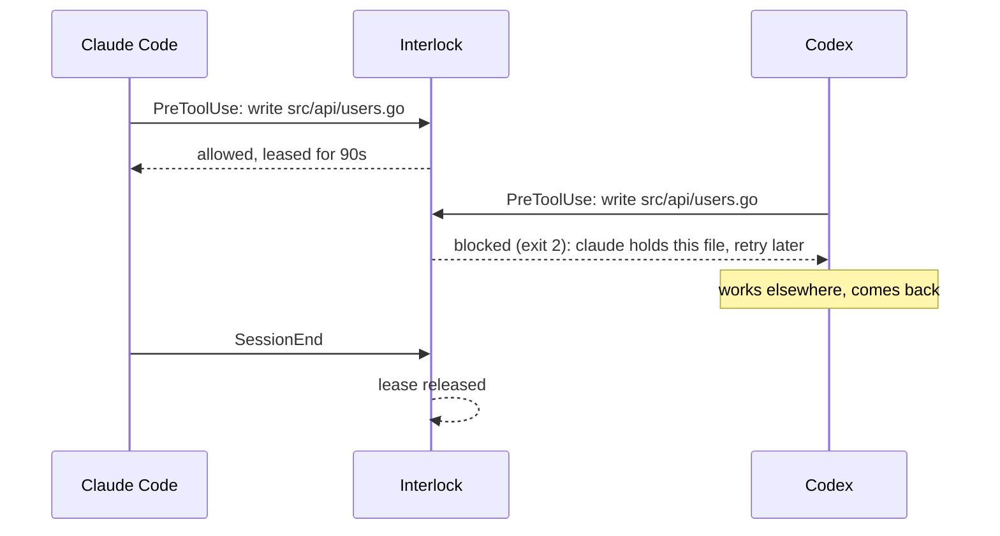

<div align="center">

<picture>
  <source media="(prefers-color-scheme: dark)" srcset="docs/wordmark-dark.svg">
  
</picture>

**Let Claude Code and Codex edit the same checkout at the same time without overwriting each other's files.**


</div>

## What it does

Two coding agents in one working tree will clobber each other. One writes a
file, the other writes the same file a moment later, and the first edit is gone
with nothing to say it happened. The usual fix is isolation: a git worktree per
agent. That works, but you are no longer working in one checkout.

Interlock keeps a single checkout and coordinates the agents instead. It installs
itself as a hook in each agent, so every file write passes through it. A write
takes a short lease on the file. A second agent that tries to write the same file
is refused, told who holds it, and told to come back later. Both agents are also
told who else is working and where, so most of the time they stay out of each
other's way without being refused anything.

It is a single static Go binary with one runtime dependency. Nothing to run in
the background, no server required.

## Features

- **File leases.** Writing a file holds it for 90 seconds, renewed on every
  touch and released when the session ends. A conflicting write is blocked
  before it happens.
- **Shell-command scanning.** `sed -i`, `tee`, redirects, `xargs` wrappers and
  formatters are parsed for the paths they will write, so the edit tool is not
  the only way in.
- **After-the-fact verification.** For commands whose targets cannot be known in
  advance (`python3 build.py`), the git tree is snapshotted before and after,
  and anything written out of bounds is reported back to the agent.
- **Awareness.** On session start each agent is told which other agents are live
  and which directories they are working in.
- **Cooperative checks.** `interlock check <path>` lets an agent ask before it
  edits; exit 0 is free, exit 2 is held.
- **Managed runs.** `interlock run` starts a headless agent that Interlock owns,
  with pause, resume and stop controls that signal the whole process group.
- **Local dashboard.** A loopback-only web panel shows who holds what, recent
  collisions, and run controls. It loads nothing from the network.

<picture>
  <source media="(prefers-color-scheme: dark)" srcset="docs/panel-dark.png">
  
</picture>

## Quick start

Requires Go 1.26 and macOS or Linux.

```bash
go install github.com/gshepptech/interlock/cmd/interlock@latest

cd /path/to/your/repo
interlock init            # wire hooks into Claude Code and Codex for this repo
interlock doctor --smoke  # run each installed hook end to end and confirm it enforces
interlock dashboard       # optional: the panel on http://127.0.0.1:7717
```

Then start Claude Code and Codex in that repository and give them work.
`interlock init --dry-run` shows every change before it is made, and
`interlock init --uninstall` removes only what Interlock added.

## How it works



**Hooks.** `interlock init` merges hook entries into each agent's own settings
and never replaces what is there:

| Agent | Settings file | Events |
|---|---|---|
| Claude Code | `.claude/settings.local.json` | `SessionStart`, `PreToolUse`, `PostToolUse`, `SessionEnd` |
| Codex | `.codex/hooks.json`, plus trust entries in `~/.codex/config.toml` | `SessionStart`, `PreToolUse`, `PostToolUse` |

Every hook runs `interlock hook <event> <agent>`. One package (`internal/hookio`)
turns each vendor's payload into a single normalised event, so nothing
downstream knows which agent it is talking to.

**Leases and holds.** On `PreToolUse` Interlock works out which files the call
will write: the path for an edit tool, the paths inside a Codex `apply_patch`
diff, or the likely targets of a shell command. It then takes a lease on each
one. Leases live under `.interlock/` in the repository and are guarded by an
advisory `flock`, which the kernel releases if a process dies. A lease expires on
its own after 90 seconds without a touch, so a crashed agent never holds a file
for long.

**On conflict.** The hook exits with code 2, which both agents treat as "do not
run this tool call". The message names the holder and says it is a timing
conflict, not a permission problem. That wording matters: phrased as a
permission error, agents look for another way in, such as a shell command;
phrased as scheduling, they wait and retry. The refusal is also written to a
small journal that the dashboard shows.

**Instructions.** `interlock init` adds a short block to `AGENTS.md` telling
agents to run `interlock check <path>` before editing. An agent that asks first
never has a write refused. The hook is what happens when it does not ask.

**Supported agent versions.**

- **Claude Code**: enforced through its hooks.
- **Codex CLI 0.147 and later**: enforced. Codex only runs hooks it trusts, so
  `interlock init` writes the hook hashes into `~/.codex/config.toml` next to the
  project's trust entry. `interlock doctor` reports whether hooks have actually
  fired in this repository, rather than relying on a version number.
- **Codex 0.146 and earlier**: these releases ignore persisted hook trust. Start
  Codex with `interlock codex`, which passes the flag that runs hooks without
  trust and refuses to start if `.codex/hooks.json` holds anything Interlock did
  not write. Without it, those versions are coordinated only through the
  `AGENTS.md` instructions.

**Managed runs.** `interlock run codex "prompt"` starts an agent under a small
supervisor that Interlock owns. Lifecycle commands talk to that supervisor, and
it signals the process group it created; no signal is ever sent to a stored pid,
which could belong to an unrelated process by the time it is read. A graceful
stop that is ignored is not escalated automatically. Agents Interlock did not
start are shown as `observed` and get no process controls.

### Design rules

- **Never be the reason work stopped.** Only a real conflict blocks. An
  unreadable payload, a broken config, or no config at all allows the call and
  says so.
- **Reads never mutate.** Expired leases are skipped, not deleted, so readers
  never contend with writers and the dashboard needs no lock.
- **Go, one static binary.** A hook runs on every tool call, so process start is
  on the hot path. The only dependency is a TOML parser, used to edit the Codex
  config safely.

### Known limits

- Writes from commands whose targets cannot be read in advance are caught after
  the fact, not before. Outside a git repository they cannot be caught at all,
  and `doctor` says so.
- Claude Code and Codex only. Other agents with hook support need one adapter in
  `internal/hookio`.
- Unix only. Leases depend on `flock`. On other platforms every lock call
  returns an error rather than running without locks.
- `interlock run` is headless only. For an interactive session, start the agent
  yourself and let the hooks coordinate it.

## Usage

| Command | What it does |
|---|---|
| `interlock init [--dry-run] [--uninstall]` | Install, preview, or remove the hooks, Codex trust entries and `AGENTS.md` block |
| `interlock init --with-territory` | Also write an optional territory file (below) |
| `interlock doctor [--fix] [--smoke]` | Find, repair, and end-to-end test installation problems |
| `interlock check <path>...` | Ask whether a file is free: exit 0 free, 2 held |
| `interlock status [--json]` | Who is working, and who holds which files |
| `interlock dashboard [--addr A]` | Serve the panel, loopback only, default `127.0.0.1:7717` |
| `interlock codex [args...]` | Launch Codex with hooks forced on, for releases before 0.147 |
| `interlock run <runner> "prompt"` | Start a managed agent and follow its output; `Ctrl-C` detaches |
| `interlock runs list\|show\|logs` | Inspect managed runs |
| `interlock runs pause\|resume\|stop\|retry ID --confirm ID` | Control one managed run |
| `interlock cleanup [--dry-run]` | Remove state left by expired sessions |
| `interlock lease release ID --confirm ID` | Release one session's file holds |
| `interlock handoff request\|list\|show\|resolve` | Ask another agent or team to take over a piece of work |
| `interlock next` / `interlock run <runner> --next` | Show, or start an agent on, the top item from a [keep](https://github.com/gshepptech/keep) work queue if one is installed |

**Territory (optional).** Most repositories never need rules. When they do,
`interlock init --with-territory` writes a file like this:

```json
{
  "teams": {
    "backend":  { "owns": ["src/api/**", "migrations/**"], "shared": ["src/types/**"], "agents": ["claude"] },
    "frontend": { "owns": ["src/components/**"], "agents": ["codex"] }
  }
}
```

A team can mix vendors. Set `INTERLOCK_TEAM` to put one session on a team other
than its agent's default.

## Development

```bash
go build ./...
go vet ./...
go test ./...
```

The tests include cross-process lease races and end-to-end runs of the built
binary against fake agents. `internal/hookio/testdata` holds hook payloads
captured from real Claude Code and Codex sessions, so a change to either
vendor's envelope shows up as a failing test.

```
cmd/interlock/          the CLI, and tests that run the built binary
internal/hookio/        payload normalisation, the only vendor-aware code
internal/lease/         one holder per file, flock-guarded
internal/session/       who is here and what they last touched
internal/shellscan/     paths a shell command is likely to write
internal/gitstate/      what a command actually changed
internal/verification/  snapshots for commands that cannot be judged in advance
internal/install/       merging hooks into each agent's settings
internal/diagnostic/    doctor: checks, repairs, smoke tests
internal/managedrun/    runs Interlock owns: records, logs, supervisor
internal/dashboard/     the panel, server-rendered
```

See [CONTRIBUTING.md](CONTRIBUTING.md) for how to propose changes.

## License

MIT. See [LICENSE](LICENSE).
