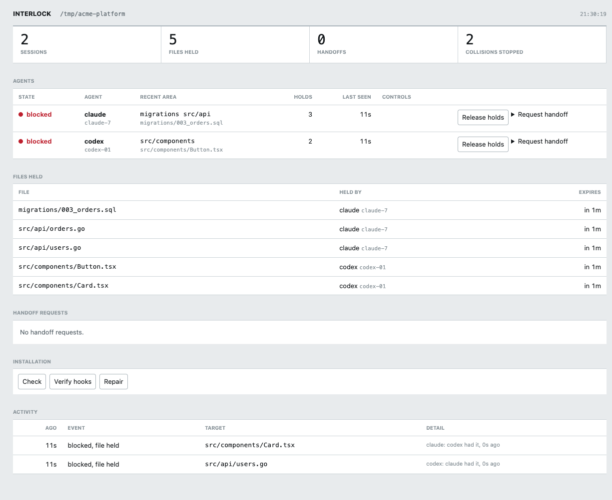
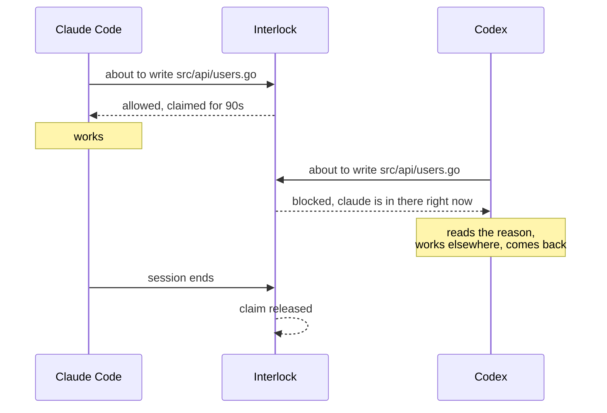

<div align="center">

<picture>
  <source media="(prefers-color-scheme: dark)" srcset="docs/wordmark-dark.svg">
  
</picture>

### Run two AI coding agents in one repo without them overwriting each other

Open Claude Code in one terminal. Open Codex in another. Give them both work.<br>
They see each other. Nothing to configure.

<br>


</div>

---

## The problem

Two agents in one checkout will silently clobber each other. One writes a file,
the other writes the same file, and the first edit is gone with nothing to say it
ever happened.

Every existing answer is **isolation**: give each agent its own git worktree so
they cannot collide because they cannot see each other's files. That works, and
it means you are no longer working in one checkout.

Claude Code's own agent teams share a checkout and have **no file conflict
enforcement at all**. The documented answer is:

> Two teammates editing the same file leads to overwrites. Break the work so each
> teammate owns a different set of files.

That is an instruction to the human. Interlock is that instruction, enforced.

---

## What it looks like

<picture>
  <source media="(prefers-color-scheme: dark)" srcset="docs/panel-dark.png">
  
</picture>

A signalling panel, because an interlocking is one. Files are track sections that
are occupied or clear. Observed agents show **green** recent, **amber** quiet,
or **red** blocked activity without pretending hook recency proves active work.

---

## Quick start

```bash
go install github.com/gshepptech/interlock/cmd/interlock@latest

cd /your/repo
interlock init        # wires the hooks and trusts the exact Codex commands
interlock doctor      # confirms it is actually enforcing
interlock doctor --smoke # executes each installed hook command end to end
interlock dashboard   # the panel, on 127.0.0.1:7717
```

Then open your agents and give them work. That is the whole setup.

> [!NOTE]
> **Codex is enforced, as of `codex-cli 0.147`.** Codex will not run a hook it
> does not trust, and `interlock init` grants that trust by writing the hook's
> hash into `~/.codex/config.toml` alongside the project's own trust entry.
> Verified against a real session on `0.147.0-alpha.6.5`: Codex tried to write
> a file another agent held, the `PreToolUse` hook refused it three times, and
> the file was untouched.
>
> This is a change. Earlier versions did not honour those entries, and the
> instructions path below was the honest ceiling. The exact release that fixed
> it is not established — only that `0.146` did not work and `0.147` does — so
> `interlock doctor` reports whether hooks have actually fired here rather than
> asking you to trust a version number.
>
> The `AGENTS.md` section stays, and is not redundant. In the same test with
> the hooks live, Codex read it, ran `interlock check`, found the file held,
> and waited rather than attempting the write at all. Being told beforehand is
> better than being refused afterwards; the hook is what happens when it is not.
>
> `interlock codex` remains for older versions. It passes the flag that runs
> hooks without trust, and because that flag also disables Codex's vetting of
> hook commands, the launcher refuses to start when `.codex/hooks.json` holds
> anything Interlock did not write. On 0.147 you do not need it.

---

## How it works

Hooks to refuse, instructions to redirect.

A hook fires whether or not the model cooperates, which is why both agents'
writes are genuinely blocked. But a refusal is a poor way to be told something:
by the time it arrives the agent has already decided what to do and has to
work out why it failed. So the repository's instructions tell an agent to run
`interlock check` before it edits, and both agents do — they find the file held
and go elsewhere without ever attempting the write.

The instructions are how an agent finds out. The hook is what happens when it
does not ask.



### Agents Interlock started, and agents it merely noticed

Everything above is about an agent that turned up: you started it, its hooks
fire, and Interlock infers what it can from them. `interlock run` is the other
half. Interlock starts the agent itself, so it owns the process and can say what
it is doing rather than what it recently did.

```bash
interlock run codex "implement the invitation API" --name api
interlock runs list
interlock runs pause run-… --confirm run-…
interlock runs stop  run-… --confirm run-…
```

The two are kept apart on purpose, in the vocabulary as well as the code. A run
Interlock started can be paused, resumed and stopped, and its state is a fact.
An agent it only observed is labelled `observed` and is offered no process
controls at all, because Interlock does not own it and pretending otherwise
would be the panel lying to you.

Three rules make the owned half trustworthy:

- **No signal is ever sent to a stored process id.** A pid is a number that was
  true when it was written, and by the time anything reads it the process may
  have exited and the number may belong to something you are using. Every
  lifecycle command talks to the run's own supervisor and asks it to signal the
  group it created.
- **Signals go to the whole process group.** Agents spawn things, and stopping
  only the process Interlock started would leave that tree writing to your
  repository after the run was supposedly over.
- **Nothing is escalated automatically.** A graceful stop the agent ignores
  leaves the run saying force is required, and there it stays. Killing an agent
  part way through writing a file is a decision for a person.

If a supervisor dies, the run is marked `lost` rather than guessed at: Interlock
will not signal a process it can no longer prove is the right one.

### Three layers, in the order they do work

| | | |
|---|---|---|
| **Awareness** | Needs no rules, does most of the work | Each agent is told who else is live and which directories they are working in. An agent that knows where its peer is usually stays out of the way without ever being refused anything. |
| **Claims** | The backstop | Writing a file claims it for 90 seconds, renewed on every touch, released when the session ends. A second agent is refused and told who has it. |
| **Instructions** | So an agent can find out before it is refused | `AGENTS.md` carries one rule: run `interlock check <path>` before editing, and treat exit 2 as a scheduling conflict rather than a permission one. A live Codex session followed it — checked, found the file held, waited, and never attempted the write. That is cooperative, and the claim above is what happens when an agent does not ask. |
| **Verification** | For what cannot be judged in advance | `python3 build.py` writes somewhere and nothing before it runs says where. The tree is snapshotted either side of the command, and anything that landed out of bounds is reported back to the agent, which can then revert it. |

<details>
<summary><b>Why the wording of a refusal matters more than it sounds</b></summary>

<br>

The block message says, in these words, that it is **a timing conflict, not a
permission one**.

An earlier version phrased it as a permission problem, and agents responded by
looking for another way in: a shell command, an interpreter, anything that was
not the tool that had just refused them. Framing it as scheduling is what makes
an agent wait and retry instead of routing around the guard.

Same mechanism, opposite behaviour, purely from the sentence.

</details>

<details>
<summary><b>Closing the obvious bypass</b></summary>

<br>

Enforcement only at the edit tool is sidestepped by `sed -i`. Shell commands are
scanned for the paths they are likely to write, which turned out to need real
care:

- `sed -n '1,10p' file` **reads**, and flagging it would block normal work
- `find . | xargs sed -i ...` hides the real command behind a wrapper
- `cd src && tee ../src/api/users.go` means `src/api/users.go`
- `"$TARGET"` cannot be resolved at all, and pretending otherwise is worse than
  admitting it

What cannot be resolved is reported rather than blocked, then verified after the
fact. Blocking every `python3` invocation would get the tool uninstalled.

</details>

<details>
<summary><b>Optional: hard rules, when the automatic behaviour cannot infer one</b></summary>

<br>

Most repos never need this. `interlock init --with-territory` writes:

```json
{
  "teams": {
    "backend":  { "owns": ["src/api/**", "migrations/**"], "shared": ["src/types/**"], "agents": ["claude"] },
    "frontend": { "owns": ["src/components/**"], "agents": ["codex"] }
  }
}
```

A team can span vendors: two Claude sessions and a Codex session can all be
`backend`. `INTERLOCK_TEAM` puts one session on a team other than its agent's
default. Everything automatic still applies on top.

</details>

---

## Proof

Not a description of intended behaviour. These are real Claude Code and Codex
sessions in one shared checkout.

**Two agents, running at the same time, nothing configured.** Claude was told to
make three separate edits to `src/shared.ts`. While it worked, Codex was told to
add a comment to the same file. Codex reported:

> The first write was blocked because `claude` held `src/shared.ts`. I waited,
> re-read the file, saw another comment had been added, then applied the
> requested comment without removing that change.

All four edits survived. Neither agent lost the other's work, and neither was
told anything by a human.

<details>
<summary><b>More of the record</b></summary>

<br>

**Territory, both directions.** With `claude` on backend and `codex` on frontend:

| Agent | Own territory | The other team's |
|---|---|---|
| Claude Code | `src/api/users.go` created | `src/components/Button.tsx` blocked |
| Codex | `src/components/Card.tsx` created | `src/api/orders.go` blocked |

**The shell bypass.** Claude, told to `sed` a file outside its territory, was
blocked and offered to hand the work to the owning team instead.

**Verification.** An interpreter write that slipped past the guard was caught
afterwards, reported into the agent's context, and reverted.

**`init` against a real settings file** holding a model choice, a permissions
block and the user's own `PreToolUse` guard: added its hooks, left all three
intact, kept the user's guard first, wrote a backup, and reported "already wired
up" on a second run.

</details>

---

## Commands

| | |
|---|---|
| `interlock init` | Wire the hooks into each agent's own settings and trust the exact Codex hook commands. Merges, never replaces. Safe to run twice. |
| `interlock init --dry-run` | Show exactly what would change first. |
| `interlock init --uninstall` | Take only our hooks back out. |
| `interlock doctor` | Find the ways this can be installed and silently not enforce. |
| `interlock doctor --fix` | Repair missing or stale hooks, trust, and ignore state, then check again. |
| `interlock doctor --smoke` | Execute each exact installed session hook and verify its state appears. |
| `interlock cleanup [--dry-run]` | Remove sessions and related runtime state after their observation expires. |
| `interlock cleanup --session ID --confirm ID` | Remove one expired session after rechecking it under lock. |
| `interlock lease release ID --confirm ID` | Release only one session's file holds. |
| `interlock handoff request\|list\|show\|resolve` | Manage the bounded lightweight handoff request queue. |
| `interlock status` | Territory and who holds what, in the terminal. |
| `interlock run <runner> "prompt"` | Start an agent Interlock owns, and follow its output. `Ctrl-C` detaches; it does not stop the agent. |
| `interlock runs list\|show\|logs` | See the agents Interlock started and what they have said. |
| `interlock next` | What is workable right now, if a work store says. Nothing here depends on having one. |
| `interlock run <runner> --next` | Start an agent on the top ready item, briefed from it. |
| `interlock runs pause\|resume\|stop\|retry ID --confirm ID` | Control one of them. `stop --force` kills it, and is only offered once a graceful stop has been ignored. |
| `interlock dashboard` | The loopback-only panel, including the run launcher and controls, plus stale-session, lease, diagnostic, and handoff controls. |

---

## Design rules

- **This tool must never be the reason someone's work stopped.** A real conflict
  is the only thing that blocks. An unreadable payload, a broken config, or no
  config at all allows the call and says so. Allowing costs a collision you could
  already have had; blocking on our own bug costs a session that cannot write to
  its own repo.
- **Nothing vendor-specific escapes one package.** Everything downstream works on
  a single normalised event, so a new agent is one adapter and nothing else.
- **Reads never mutate.** Expired claims are skipped, not deleted, so a reader
  and a writer never contend and the panel needs no lock.
- **One runtime dependency, and it had to earn its place.** A hook runs on every
  tool call, so the artifact is one static binary with nothing to resolve at
  startup. That is also why this is Go and not Node: process start is on the hot
  path. The exception is a TOML parser, taken on because repairing Codex's trust
  configuration means editing a file the user owns, and doing that with string
  matching is how you corrupt someone's setup.
- **The panel fetches nothing external.** No external script, font, CDN, or
  telemetry. Its small same-origin status refresh and confirmed actions stay on
  the loopback server. Rendered paths, model names, and notes are escaped. With
  JavaScript disabled, it remains a read-only status panel and hides controls.

<details>
<summary><b>Three bugs worth recording</b></summary>

<br>

**The pid trap.** Claims first reclaimed any claim whose recorded process had
exited, to recover quickly from a crash. A cross-process test found this made
*every* claim stealable: the hook is a short-lived process that exits
milliseconds after acquiring, so its pid is always dead. Three of twelve racing
processes were each granted the same file. The in-process race test passed the
entire time.

**The hook that never fired.** `PreToolUse` matched `Bash`; `PostToolUse` did
not. So the tree was snapshotted before every unresolvable command and nothing
ever compared it. Verification was dead on arrival while every unit test passed,
and only a live agent session surfaced it.

**The guard that blocked its own fix.** Verification told an agent it had written
out of bounds and to revert it. The agent tried to delete the file and the guard
blocked that too. The tool demanded a fix and then prevented it. A flagged path
is now writable by the session told to fix it, for that path only and for fifteen
minutes.

All three are covered by tests that were confirmed to fail when the bug is put
back.

</details>

---

## Status

Working, and verified end to end against real Claude Code and Codex sessions on
one machine. Not yet used in anger.

The [roadmap](ROADMAP.md) takes the coordination core through dashboard control,
managed agent processes, durable tasks and handoffs, plan orchestration,
worktree strategies, policy and approvals, and a stable v1 release.

**Known limits, stated plainly, because a coordination tool that implies coverage
it does not have is worse than none:**

- Writes from commands whose target cannot be read in advance are caught *after*
  the fact, not before. Outside a git repo they cannot be caught at all, and
  `doctor` says so.
- Claude Code and Codex only. Cursor and Gemini CLI both have hooks and should
  slot in without touching anything else.
- Unix only. Claims need an advisory lock the kernel releases on process death.
  Windows would need `LockFileEx`, and the build fails loudly rather than
  degrading into a racing no-op.
- No automated test drives the two real agents against each other. Every
  cross-vendor claim above was verified by hand.
- `interlock run` starts agents headless. There is no way to type into one; if
  you want a conversation, start the agent yourself and let the hooks coordinate
  it. Asking for an interactive run is refused rather than quietly downgraded.
- The exact `codex exec` and `claude --print` invocations are exercised against
  fake agents in the test suite. Running them against the real CLIs is the
  opt-in acceptance script, not part of `go test ./...`.

---

## Repository

```
cmd/interlock/        the CLI, and tests that run the built binary
internal/hookio/      payload normalisation, the only vendor-aware code
internal/lease/       one holder at a time, flock-guarded
internal/session/     who is here and what they last touched
internal/shellscan/   paths a shell command is likely to write
internal/gitstate/    what a command actually changed
internal/verification/ pending snapshots for opaque command checks
internal/remedy/      narrow permission to undo a flagged write
internal/journal/     what was prevented, capped
internal/territory/   optional path rules
internal/runner/      launch options to an exact command, per agent
internal/managedrun/  runs Interlock owns: records, logs, supervisor, liveness
internal/runcontrol/  shared typed run actions for CLI and dashboard
internal/dashboard/   the panel, server-rendered
internal/control/     shared typed control actions for CLI and dashboard
internal/controlhttp/ strict loopback HTTP envelope for control actions
internal/handoffrequest/ bounded immutable request and resolution records
internal/install/     merging hooks into each agent's own settings
internal/diagnostic/  typed checks, safe repairs, and smoke verification
internal/cleanup/     explicit expiry-safe runtime cleanup
internal/state/       persisted-state schema compatibility
```

`internal/hookio/testdata` holds payloads captured from real sessions. If a
vendor changes its envelope, those tests are how we find out.

---

<div align="center">
<sub>All rights reserved.</sub>
</div>
